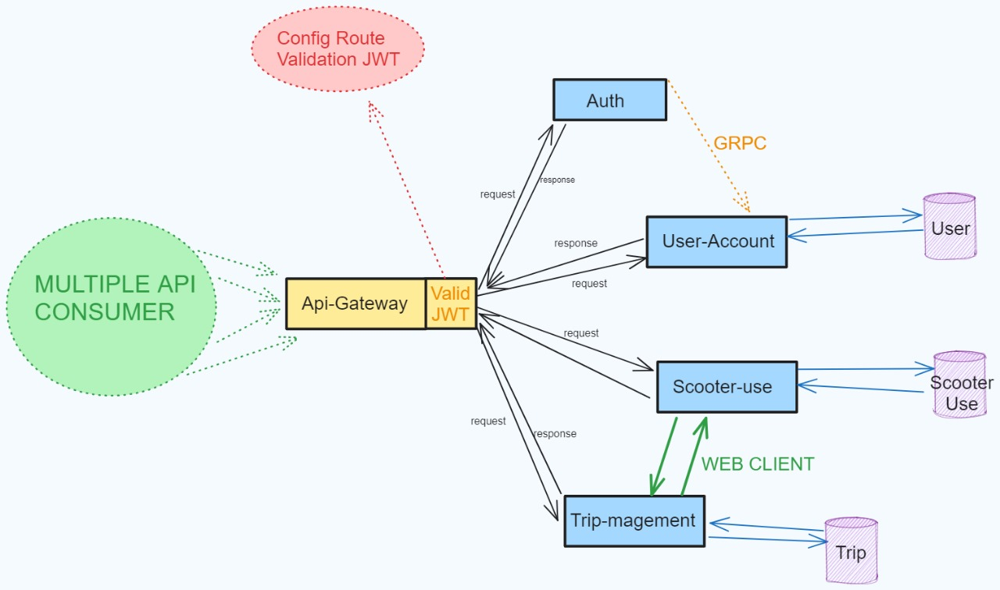

# AppMonopatines
Aplicacion para monopatines electricos

Collaborators:
- brianfreijomil
- benjaMontero02
- lucasAmendola

## Description: 
Application based on a microservices architecture using Spring boot. Each microservice uses its own database, in addition, each microservice internally uses an N-Tier architecture separating the business logic, data access and the presentation layer, facilitating its maintenance and scalability.

## Architecture Design

